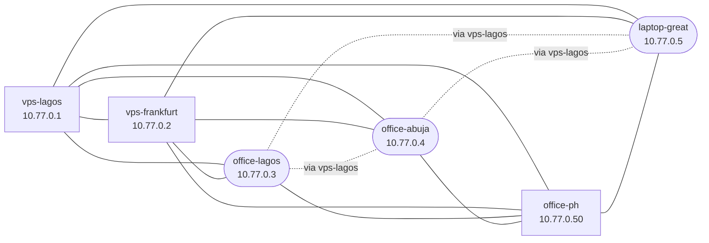

# wgmesh

Describe your WireGuard network in one YAML file. Get a ready `wg-quick` config for every node, with the NAT problems already worked out.

```yaml
network: 10.77.0.0/24
topology: mesh            # or: hub

nodes:
  vps-lagos:
    endpoint: vps1.example.net
  vps-frankfurt:
    endpoint: 203.0.113.40:51821
    listen_port: 51821
  office-lagos:
    routes: [192.168.10.0/24]    # office LAN behind this node
  office-abuja:
    routes: [192.168.20.0/24]
  office-ph:
    address: 10.77.0.50
    endpoint: 198.51.100.7
    routes: [192.168.30.0/24]
  laptop-great: {}
```

```
$ wgmesh plan examples/offices.yml
network 10.77.0.0/24  topology mesh  6 nodes  15 tunnels

node           address          endpoint                     routes
vps-lagos      10.77.0.1        vps1.example.net:51820       -
vps-frankfurt  10.77.0.2        203.0.113.40:51821           -
office-lagos   10.77.0.3        behind NAT                   192.168.10.0/24
office-abuja   10.77.0.4        behind NAT                   192.168.20.0/24
office-ph      10.77.0.50       198.51.100.7:51820           192.168.30.0/24
laptop-great   10.77.0.5        behind NAT                   -

  vps-lagos <-> vps-frankfurt
  ...
  office-lagos <-(vps-lagos)-> office-abuja
  ...
info: 3 pair(s) are both behind NAT and go via vps-lagos. Their traffic takes the long way round

$ wgmesh build examples/offices.yml -o out/
wrote out/wg0-vps-lagos.conf
...
```


*(`wgmesh graph` prints this. Rounded boxes are behind NAT.)*

## Why

A full mesh of *n* nodes is n×(n−1)/2 tunnels. Six nodes is 15 tunnels and 30 `[Peer]` blocks, each with a key, an endpoint and AllowedIPs. Writing that by hand works exactly until someone adds a seventh node.

Typing isn't the hard part, though. The hard part is that most office links here sit behind ISP NAT with no public IP:

- **Public ↔ public**: peer directly.
- **Public ↔ NAT**: peer directly. The NAT side dials out and needs `PersistentKeepalive`, otherwise the NAT mapping expires and the public side can't reach back in.
- **NAT ↔ NAT**: they can never find each other. Traffic has to go through a node that *is* reachable. In WireGuard that means the relay's `[Peer]` entry on each side carries the *other* office's AllowedIPs, and the relay forwards between them.

That last one is where hand-written configs break, and it's what wgmesh works out for you.

## What it does

- **Assigns tunnel addresses**. Explicit ones are respected, the rest are handed out in inventory order. Same file, same addresses, every run.
- **Plans the tunnels**: direct where possible, relayed through a public node where both ends are NAT'd, and an error if there's no relay at all.
- **Hub-and-spoke mode** (`topology: hub`) for when a full mesh is overkill. With two hubs, the primary carries the whole tunnel range and the secondary only its own /32. That's longest-prefix match, so it's valid.
- **Collapses AllowedIPs** (`10.77.0.4/32, 10.77.0.5/32` → `10.77.0.4/31`).
- **Turns on forwarding** (`ip_forward` + iptables FORWARD) only on nodes that need it: relays, hubs, and nodes with a LAN behind them.
- **Keepalive only on the NAT side**, so public nodes don't send pointless packets.
- **Preshared keys** per pair, for post-quantum hardening (on by default, `preshared_keys: false` to disable).
- **Keys are stored separately** in `<inventory>.keys.json` (mode 600, in `.gitignore`), so the inventory can live in git and the keys don't. Rebuilding keeps existing keys, so adding a node only changes the configs that need to change.
- **Checks**: overlapping site routes, routes overlapping the tunnel range, private IPs used as endpoints, unreachable pairs.

## Install

```
pip install git+https://github.com/GreatsLab/wgmesh
```

## Commands

```
wgmesh plan   inventory.yml            # addresses, tunnels, warnings
wgmesh build  inventory.yml -o out/    # one wg0-<node>.conf per node
wgmesh show   inventory.yml office-ph  # print one node's config
wgmesh graph  inventory.yml            # mermaid diagram
wgmesh rotate inventory.yml laptop-great   # new keys for one node (lost laptop)
```

Then on each node: copy its file to `/etc/wireguard/wg0.conf` and `wg-quick up wg0`.

## Don't forget the LAN side

If a node has `routes:` (an office LAN behind it), the *other* machines on that LAN need to know to send tunnel traffic to it. Either add a static route on the office router (`10.77.0.0/24` and the other offices' LANs → that node's LAN IP), or masquerade on the node. wgmesh can't do that part for you, because it doesn't know your office router.

## Tests

```
pip install -e . pytest && pytest
```

The tests check the things that actually break real deployments. For every node, every other node's addresses and routes must be covered by some peer's AllowedIPs (full reachability). And no prefix may appear on two peers of the same interface. My first version of that second test failed on overlapping prefixes, which WireGuard is actually fine with (the more specific one wins). The real failure is two peers with the *identical* prefix, where the second silently takes it over.

## Not done yet

- IPv6 tunnel addresses
- Choosing the closest relay per pair (right now it's the first public node)
- Output for MikroTik / OPNsense instead of wg-quick

## License

MIT
